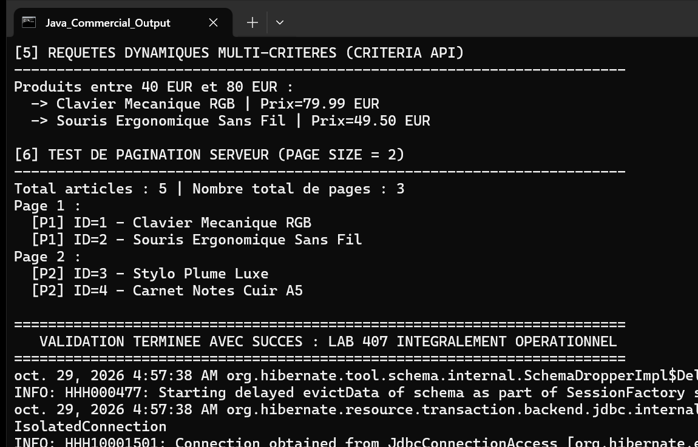

# Lab 407 : Révision — Gestion Commerciale avec Hibernate & JPA

Projet complet de révision mettant en œuvre l'ensemble des concepts avancés de JPA 2.2 et Hibernate 5.6 dans le cadre d'un système de gestion commerciale.

## Architecture et Composants Réalisés

### 1. Modélisation des Entités et Relations
- **Association 1:N bidirectionnelle :** `Categorie` et `Produit` avec cascade complète et gestion des orphelins (`orphanRemoval = true`). Méthodes de synchronisation d'état objet `addProduit` et `removeProduit`.
- **Héritage JOINED :** Classe mère abstraite `User` (table `users`) et classes dérivées `Client` (table `clients`) et `Fournisseur` (table `fournisseurs`), liées par clés étrangères primaires.
- **Association N:N avec attributs et clé composée :** Entités `Commande` et `Produit` reliées via l'entité associative `CommandeProduit` utilisant la clé primaire composite `@EmbeddedId CommandeProduitPK` et l'annotation `@MapsId`.

### 2. Couche DAO Générique
- **Classe `GenericDAO<T, ID extends Serializable>` :** Implémentation générique des opérations CRUD (`create`, `update`, `delete`, `find`, `findAll`) avec gestion stricte du cycle de vie des transactions (`begin`, `commit`, `rollback`) et fermeture des contextes de persistance.
- **Classe `ProduitDAO` :** Extension spécialisée fournissant l'exécution des requêtes nommées, la recherche multi-critères dynamique Criteria API et le requêtage paginé.

### 3. Couche Service Métier
- **Classe `CrudService<T, ID extends Serializable>` :** Encapsulation de la couche d'accès aux données, validation des paramètres et des règles de gestion (`IllegalArgumentException` sur entité ou ID nul).

### 4. Requêtes Avancées
- **Named Queries :** Déclarées sur l'entité `Produit` (`Produit.findAll`, `Produit.findByCategorie`, `Produit.searchByLibelle`).
- **Criteria API Dynamique :** Méthode `searchDynamic` combinant dynamiquement les prédicats de filtrage textuel et de fourchettes de prix (`cb.like`, `cb.ge`, `cb.le`).
- **Pagination Côté Serveur :** Méthode `findPage(int page, int size)` avec calcul du décalage (`setFirstResult`) et limitation (`setMaxResults`).

## Exécution et Tests

### Commandes Maven
Exécution de la suite de tests unitaires JUnit :
```bash
mvn clean test
```

Lancement de l'application principale de démonstration :
```bash
mvn clean compile exec:java -Dexec.mainClass="org.example.App"
```

## Résultat d'Exécution

La capture ci-dessous illustre l'exécution de la classe principale `org.example.App`.



### Description de la Capture
- L'en-tête atteste du démarrage de l'application et de l'unité de persistance `defaultPU`.
- Section 1 : Persistance réussie des catégories (`Informatique`, `Papeterie & Fournitures`, `Mobilier de Bureau`) et de leurs 5 produits associés.
- Section 2 : Démonstration de la stratégie d'héritage `JOINED` avec la lecture polymorphique des instances de `Client` et `Fournisseur`.
- Section 3 : Création d'une commande et de lignes de commande via la table associative à clé composée `@EmbeddedId`.
- Section 4 : Exécution des Named Queries JPA pour filtrer par catégorie et par terme de libellé.
- Section 5 : Exécution d'une recherche dynamique via Criteria API (produits filtrés entre 40 EUR et 80 EUR).
- Section 6 : Démonstration de la pagination serveur (Page 1 et Page 2 avec taille de page fixée à 2).
- Validation générale sans erreur.
